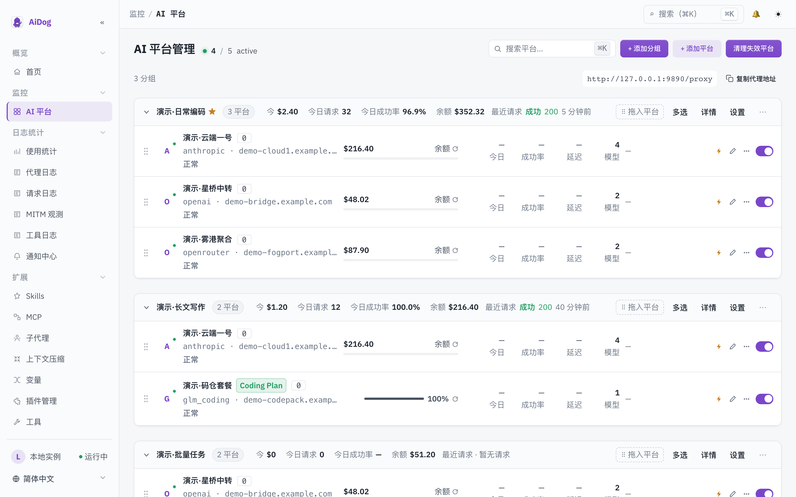

<div align="center">

# AiDog

**Управляйте ИИ-платформами на своём компьютере и перенаправляйте запросы клиентов на выбранные платформы.**

Настольное приложение с локальным прокси, групповой маршрутизацией, сопоставлением моделей, журналом запросов и оценкой использования.

[Документация](https://lazygophers.github.io/aidog/en/) · [Последний релиз](https://github.com/lazygophers/aidog/releases/latest) · [Сообщить о проблеме](https://github.com/lazygophers/aidog/issues)

[简体中文](README.md) · [English](README.en.md) · [Français](README.fr.md) · [Deutsch](README.de.md) · Русский · [العربية](README.ar.md) · [Español](README.es.md) · [日本語](README.ja.md)

</div>

AiDog запускает прокси-службу на вашем компьютере. Вы сохраняете вышестоящие платформы и API-ключи в AiDog, а затем подключаете Claude Code, Codex, pi или другие совместимые клиенты к локальному прокси. Запросы по-прежнему отправляются на выбранную вышестоящую платформу; локальная работа не означает, что запросы остаются на вашем компьютере.

## Кому подходит

- Вы пользуетесь несколькими ИИ-сервисами и хотите управлять учётными данными платформ и моделями в одном приложении.
- Вы хотите, чтобы разные клиенты использовали разные группы, сопоставления моделей или платформы-кандидаты.
- Вам нужно просматривать статус запросов, использование, оценку стоимости и результаты маршрутизации.
- Вы хотите, чтобы Claude Code, Codex или pi использовали один локальный вход прокси.

## Возможности




*Скриншоты для иллюстрации, данные смоделированы.*

### Локальный прокси и маршрутизация

- Управляйте встроенными пресетами платформ и настраивайте собственные платформы.
- Изолируйте запросы клиентов с помощью групп и связывайте с каждой группой свои платформы.
- Выбирайте платформы-кандидаты по сопоставлению моделей, протоколу эндпоинта и доступности.
- Слоты с несколькими моделями поддерживают упорядоченные цепочки моделей; при сбое запроса пробуются следующие кандидаты.
- Поддерживается перенаправление и адаптация протоколов OpenAI, Anthropic, Gemini и других; реальные возможности зависят от эндпоинта платформы и типа запроса.
- Поддерживаются правила промежуточного слоя, настройка моделей по временным интервалам и планирование маршрутизации по состоянию.

### Журналы и статистика

- Просматривайте запросы прокси и отдельные записи тестов, запросов баланса и списков моделей.
- Сохраняйте или очищайте исходное содержимое с обеих сторон запроса согласно настройкам; чувствительные заголовки запросов маскируются.
- Оценивайте стоимость на основе использования в ответах и встроенных цен на модели. Оценки не заменяют биллинг вышестоящей платформы.
- Просматривайте балансы платформ, квоты и статистику использования по группам; эти показатели считаются по разным методикам и не являются прямым эквивалентом друг друга.

### Клиенты и инструменты

- Управляйте конфигурациями Claude Code, Codex и pi, формируйте инструкции подключения для каждой группы.
- Управляйте MCP-серверами, навыками, уведомлениями и системными настройками.
- При необходимости запускайте headless-ядро и управляйте им через API, доступ к которому ограничен локальной машиной.

## Установка

Скачайте установщик для вашей системы со страницы [GitHub Releases](https://github.com/lazygophers/aidog/releases/latest). Доступные пакеты, архитектуры и требования для каждой системы указаны на странице соответствующего релиза.

После запуска AiDog локальный прокси по умолчанию слушает `127.0.0.1:9890`. По умолчанию используется только loopback-адрес; не пробрасывайте API управления в публичный интернет.

## Быстрый старт

1. Добавьте платформу в разделе «ИИ-платформы» и укажите протокол, Base URL и API-ключ вышестоящей платформы.
2. Создайте группу на странице платформ и добавьте в неё платформы.
3. В клиенте используйте команду подключения, сгенерированную для группы, или настройте адрес локального прокси и учётные данные группы по инструкции клиента.
4. Отправьте запрос и проверьте в журнале прокси группу, вышестоящую платформу, модель и результат.

[Руководство по установке](/en/getting-started/installation) · [Первая настройка](/en/getting-started/first-config) · [Проверка первого запроса](/en/getting-started/first-request)

## Данные и приватность

AiDog хранит настройки и базы данных на вашем компьютере. Прокси-запросы передают необходимое содержимое выбранной вышестоящей службе. Сохраняются ли в журналах тела запросов и ответов — зависит от настроек журналирования; при отключённой записи исходного содержимого метаданные (статус, модель, использование) всё равно могут записываться. Подробнее: [Данные и приватность](/en/core-concepts/data-privacy).

## Сборка из исходников

Сначала установите инструменты и системные зависимости согласно [официальным требованиям Tauri](https://v2.tauri.app/start/prerequisites/).

```bash
git clone https://github.com/lazygophers/aidog.git
cd aidog
yarn install
yarn tauri dev
```

Сборка установщика:

```bash
yarn tauri build
```

## Лицензия

AiDog распространяется по лицензии [GNU AGPL-3.0-or-later](LICENSE).
