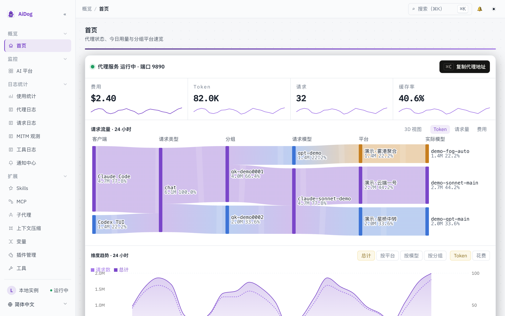

*界面示意，数据为模拟。*

## 开始使用

1. [安装 AiDog](/getting-started/installation)。
2. [添加平台并创建分组](/getting-started/first-config)。
3. [连接 Claude Code、Codex 或 pi](/getting-started/connect-claude-code)。
4. [发送并检查首个请求](/getting-started/first-request)。

AiDog 在本机运行代理。请求会转发到你配置的上游服务；本机运行不表示请求只留在本机。

## 按任务查找

- [管理 AI 平台](/features/platforms)
- [分组与路由](/core-concepts/groups-routing)
- [查看请求记录](/features/logs)
- [查看用量与费用估算](/features/stats)
- [数据与隐私](/core-concepts/data-privacy)
